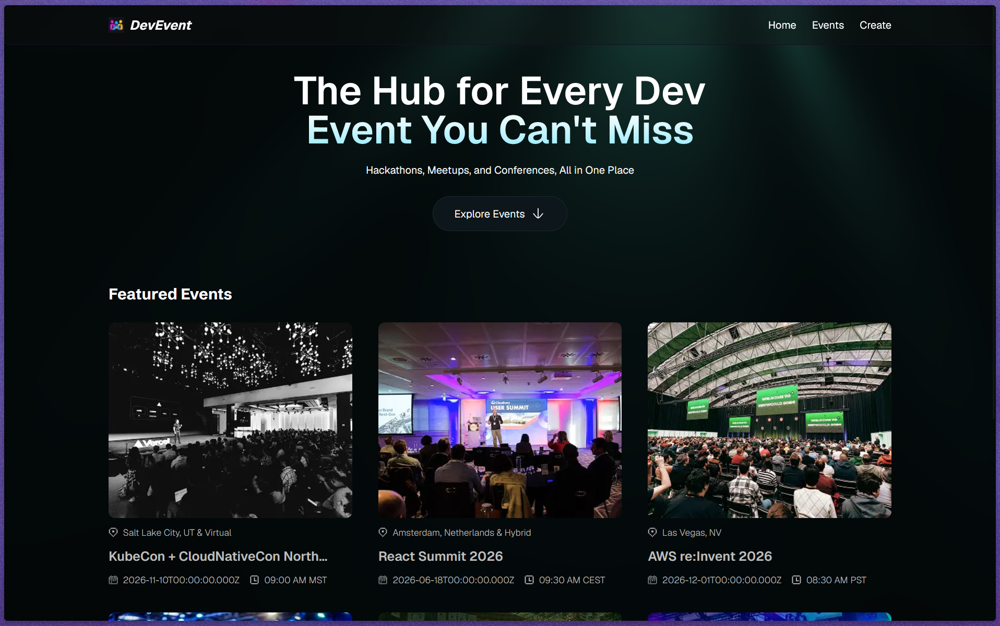
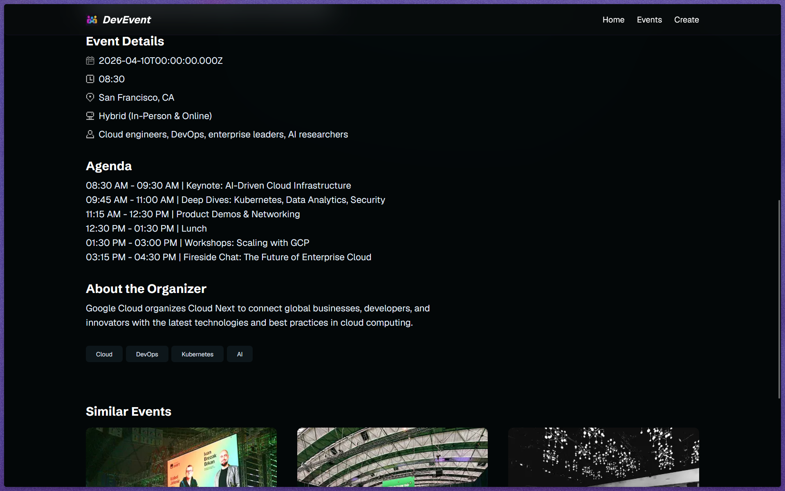
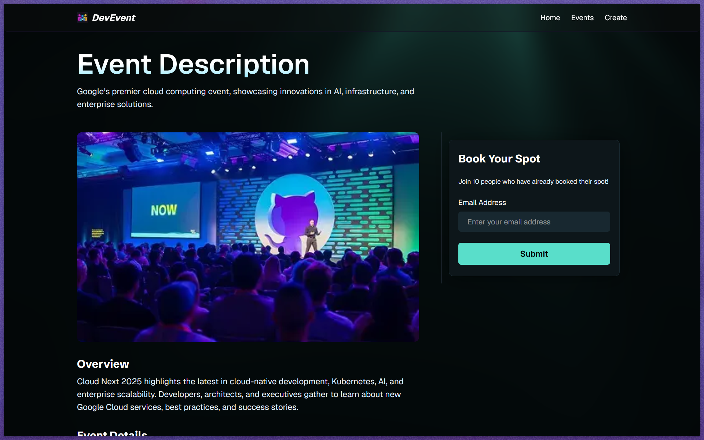
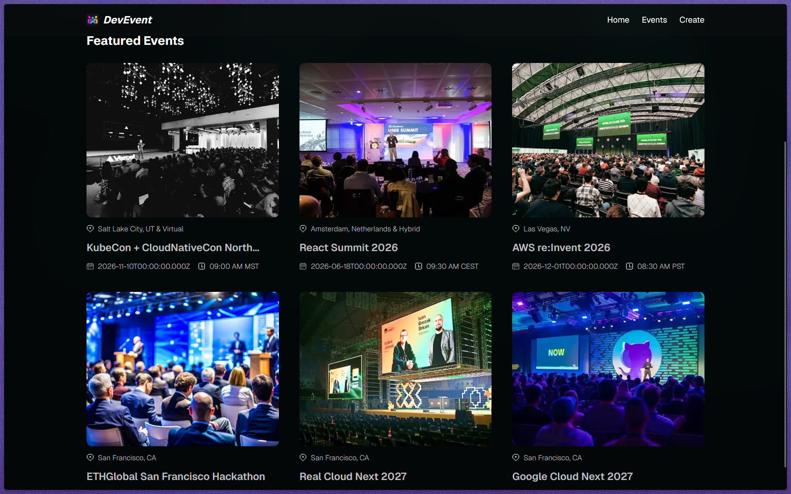

<div align="center">

<!-- Hero Section -->


# 🎯 DevEvent

### *The Hub for Every Dev Event You Can't Miss*

Hackathons, Meetups, and Conferences — All in One Place.

[](https://devevents-nine-gamma.vercel.app/)
[](https://nextjs.org/)
[](LICENSE)
[](CONTRIBUTING.md)

<br />

[**Explore Events →**](https://devevents-nine-gamma.vercel.app/) · [Report Bug](../../issues) · [Request Feature](../../issues)

</div>

<br />

---

<br />

## 📸 Screenshots

<div align="center">

| Homepage | Event Details |
|:---:|:---:|
|  |  |

| Event Booking | Featured Events |
|:---:|:---:|
|  |  |

</div>

<br />

---

<br />

## ✨ Features

<table>
<tr>
<td width="50%">

### 🎪 Event Discovery
Browse a curated collection of developer events — hackathons, conferences, meetups — all fetched in real-time from a MongoDB database.

### 🎟️ One-Click Booking
Sign up for any event instantly via email. The booking system validates your input, links it to the event, and confirms in real time.

### 🔍 Similar Events
Every event page recommends similar events based on shared tags, so you never miss what's relevant to you.

</td>
<td width="50%">

### 🌈 Stunning Visuals
WebGL-powered light ray animations built with OGL create a mesmerizing, interactive background that follows your cursor.

### ⚡ Blazing Fast
Next.js 16 with `'use cache'` directives, React 19, and Turbopack deliver near-instant page loads and server rendering.

### 📊 Analytics Built-In
PostHog integration tracks event clicks and bookings, giving you actionable product insights out of the box.

</td>
</tr>
</table>

<br />

---

<br />

## 🛠️ Tech Stack

<div align="center">

### Core Framework

| Technology | Description |
|:---:|:---|
| [](https://nextjs.org/) | React framework with App Router, Server Components, and `'use cache'` |
| [](https://react.dev/) | UI library with Server & Client Components |
| [](https://www.typescriptlang.org/) | Type-safe development across the entire codebase |

### Styling & UI

| Technology | Description |
|:---:|:---|
| [](https://tailwindcss.com/) | Utility-first CSS framework |
| [](https://ui.shadcn.com/) | Beautifully designed, accessible components |
| [](https://lucide.dev/) | Beautiful & consistent icon set |
| -FF6B6B?style=for-the-badge&logo=webgl&logoColor=white) | WebGL-powered light ray animations |

### Backend & Database

| Technology | Description |
|:---:|:---|
| [](https://www.mongodb.com/) | NoSQL database for event & booking data |
| [](https://mongoosejs.com/) | Elegant MongoDB ODM with schema validation |
| [](https://cloudinary.com/) | Cloud-based image upload & CDN delivery |

### DevOps & Analytics

| Technology | Description |
|:---:|:---|
| [](https://vercel.com/) | Deployment & edge hosting |
| [](https://posthog.com/) | Product analytics & event tracking |
| [](https://eslint.org/) | Code quality & linting |

</div>

<br />

---

<br />

## 🏗️ Architecture

```
┌─────────────────────────────────────────────────────────────────┐
│                        CLIENT (Browser)                        │
│  ┌──────────┐  ┌──────────┐  ┌──────────┐  ┌───────────────┐  │
│  │ Homepage │  │  Event   │  │ Booking  │  │  Light Rays   │  │
│  │   Page   │  │ Details  │  │  Form    │  │ (WebGL / OGL) │  │
│  └────┬─────┘  └────┬─────┘  └────┬─────┘  └───────────────┘  │
│       │              │             │                            │
└───────┼──────────────┼─────────────┼────────────────────────────┘
        │              │             │
        ▼              ▼             ▼
┌─────────────────────────────────────────────────────────────────┐
│                    NEXT.JS 16 SERVER                            │
│                                                                 │
│  ┌──────────────────┐  ┌──────────────────┐  ┌──────────────┐  │
│  │  API Routes      │  │  Server Actions  │  │  'use cache' │  │
│  │  /api/events     │  │  createBooking() │  │  Caching     │  │
│  │  /api/events/:s  │  │  getSimilar()    │  │  Layer       │  │
│  └────────┬─────────┘  └────────┬─────────┘  └──────────────┘  │
│           │                     │                               │
└───────────┼─────────────────────┼───────────────────────────────┘
            │                     │
            ▼                     ▼
┌──────────────────┐   ┌──────────────────┐   ┌────────────────┐
│    MongoDB       │   │   Cloudinary     │   │    PostHog     │
│  Atlas Cluster   │   │   Image CDN      │   │   Analytics    │
│  ┌────────────┐  │   │                  │   │                │
│  │   Events   │  │   │  Upload & serve  │   │  Track clicks  │
│  │  Bookings  │  │   │  event images    │   │  & bookings    │
│  └────────────┘  │   │                  │   │                │
└──────────────────┘   └──────────────────┘   └────────────────┘
```

<br />

---

<br />

## 📂 Project Structure

```
devevents/
├── app/
│   ├── api/
│   │   └── events/
│   │       ├── route.ts              # GET all events, POST new event
│   │       └── [slug]/
│   │           └── route.ts          # GET single event by slug
│   ├── events/
│   │   └── [slug]/
│   │       └── page.tsx              # Dynamic event detail page
│   ├── globals.css                   # Global styles & theme
│   ├── layout.tsx                    # Root layout with fonts & LightRays
│   └── page.tsx                      # Homepage with featured events
├── components/
│   ├── BookEvent.tsx                 # Email booking form (Client Component)
│   ├── EventCard.tsx                 # Event preview card with PostHog tracking
│   ├── EventDetails.tsx              # Full event detail view with similar events
│   ├── ExploreBtn.tsx                # CTA explore button
│   ├── FeaturedEvents.tsx            # Server-fetched featured events grid
│   ├── LightRays.tsx                 # WebGL animated background (OGL)
│   └── Navbar.tsx                    # Navigation header
├── database/
│   ├── booking.model.ts              # Booking schema with validation
│   ├── event.model.ts                # Event schema with auto-slug & normalization
│   └── index.ts                      # Model exports
├── lib/
│   ├── actions/
│   │   ├── booking.actions.ts        # Server action: create booking
│   │   └── event.actions.ts          # Server action: get similar events
│   ├── constants.ts                  # Static event data
│   ├── mongodb.ts                    # MongoDB connection singleton
│   ├── posthog-logger.ts             # PostHog event logging utilities
│   └── utils.ts                      # General utility functions
├── public/
│   ├── icons/                        # SVG icons & logo
│   ├── images/                       # Event banner images
│   └── screenshots/                  # App screenshots for README
└── package.json
```

<br />

---

<br />

## 🚀 Getting Started

### Prerequisites

- **Node.js** ≥ 18.x
- **npm** or **yarn** or **pnpm**
- **MongoDB Atlas** account ([free tier available](https://www.mongodb.com/atlas))
- **Cloudinary** account ([free tier available](https://cloudinary.com/))

### 1. Clone the repository

```bash
git clone https://github.com/your-username/devevents.git
cd devevents
```

### 2. Install dependencies

```bash
npm install
```

### 3. Set up environment variables

Create a `.env.local` file in the root directory:

```env
# MongoDB connection string
MONGODB_URI=mongodb+srv://<username>:<password>@<cluster>.mongodb.net/<database>?retryWrites=true&w=majority

# Base URL for API requests
NEXT_PUBLIC_BASE_URL=http://localhost:3000

# Cloudinary (for image uploads)
CLOUDINARY_CLOUD_NAME=your_cloud_name
CLOUDINARY_API_KEY=your_api_key
CLOUDINARY_API_SECRET=your_api_secret

# PostHog analytics (optional)
NEXT_PUBLIC_POSTHOG_PROJECT_TOKEN=your_posthog_project_token
NEXT_PUBLIC_POSTHOG_HOST=your_posthog_host
```

> See [`.env.example`](.env.example) for reference.

### 4. Run the development server

```bash
npm run dev
```

Open [http://localhost:3000](http://localhost:3000) in your browser.

<br />

---

<br />

## 📡 API Reference

### `GET /api/events`

Returns all events, sorted by newest first.

**Response** `200`

```json
{
  "message": "Events fetched successfully",
  "events": [
    {
      "_id": "...",
      "title": "Next.js Conf 2026",
      "slug": "nextjs-conf-2026",
      "description": "...",
      "image": "https://res.cloudinary.com/...",
      "venue": "Moscone Center, SF",
      "location": "San Francisco, CA & Virtual",
      "date": "2026-10-24T00:00:00.000Z",
      "time": "09:00 AM PST",
      "mode": "Hybrid",
      "audience": "Developers",
      "agenda": ["Keynote", "Workshops", "..."],
      "organizer": "Vercel",
      "tags": ["Next.js", "React", "..."],
      "createdAt": "2026-10-30T..."
    }
  ]
}
```

### `GET /api/events/:slug`

Returns a single event by its URL-friendly slug.

### `POST /api/events`

Creates a new event. Requires `multipart/form-data`.

| Field | Type | Required | Description |
|:------|:-----|:--------:|:------------|
| `title` | `string` | ✅ | Event name |
| `description` | `string` | ✅ | Short description |
| `overview` | `string` | ✅ | Detailed overview |
| `image` | `File` | ✅ | Banner image (uploaded to Cloudinary) |
| `venue` | `string` | ✅ | Venue name |
| `location` | `string` | ✅ | City & region |
| `date` | `string` | ✅ | Any valid date string |
| `time` | `string` | ✅ | e.g. `09:00 AM PST` |
| `mode` | `string` | ✅ | In-Person / Virtual / Hybrid |
| `audience` | `string` | ✅ | Target audience |
| `agenda` | `JSON string` | ✅ | `["Item 1", "Item 2"]` |
| `tags` | `JSON string` | ✅ | `["Tag1", "Tag2"]` |
| `organizer` | `string` | ✅ | Organizer description |

**Response** `201`

```json
{
  "message": "Event created successfully",
  "event": { ... }
}
```

<br />

---

<br />

## 🧩 Key Implementation Details

<details>
<summary><b>🔐 Auto-Generated Slugs</b></summary>
<br />

Event titles are automatically converted to URL-friendly slugs via pre-save middleware:

```
"Next.js Conf 2026"  →  "nextjs-conf-2026"
"AWS re:Invent 2026" →  "aws-reinvent-2026"
```

Slugs are unique and regenerated whenever the title changes.
</details>

<details>
<summary><b>⏰ Date & Time Normalization</b></summary>
<br />

The event model automatically:
- Converts any valid date string to ISO 8601 format
- Validates and normalizes time strings (supports both 12-hour and 24-hour formats with optional timezone)
</details>

<details>
<summary><b>🎨 WebGL Light Rays</b></summary>
<br />

The interactive background is powered by OGL (a minimal WebGL library). Features include:
- Customizable ray origin, color, speed, and spread
- Mouse-following effect with configurable influence
- Noise and distortion parameters for organic feel
</details>

<details>
<summary><b>🗄️ Caching Strategy</b></summary>
<br />

Pages use Next.js 16's `'use cache'` directive with `cacheLife('hours')` for optimal performance:
- Homepage and event detail pages are cached at the server level
- Cache is automatically invalidated on redeployment
</details>

<details>
<summary><b>📈 PostHog Analytics Events</b></summary>
<br />

Tracked events:
- `event_details_selected` — when a user clicks on an event card
- `event_booked` — when a user successfully books an event
</details>

<br />

---

<br />

## 🤝 Contributing

Contributions are what make the open source community such an amazing place to learn, inspire, and create. Any contributions you make are **greatly appreciated**.

1. Fork the Project
2. Create your Feature Branch (`git checkout -b feature/amazing-feature`)
3. Commit your Changes (`git commit -m 'Add some amazing feature'`)
4. Push to the Branch (`git push origin feature/amazing-feature`)
5. Open a Pull Request

<br />

---

<br />

## 📄 License

Distributed under the MIT License. See `LICENSE` for more information.

<br />

---

<br />

<div align="center">

### 🌟 Star this repo if you found it useful!

Made with ❤️ and ☕

[](https://devevents-nine-gamma.vercel.app/)

</div>
